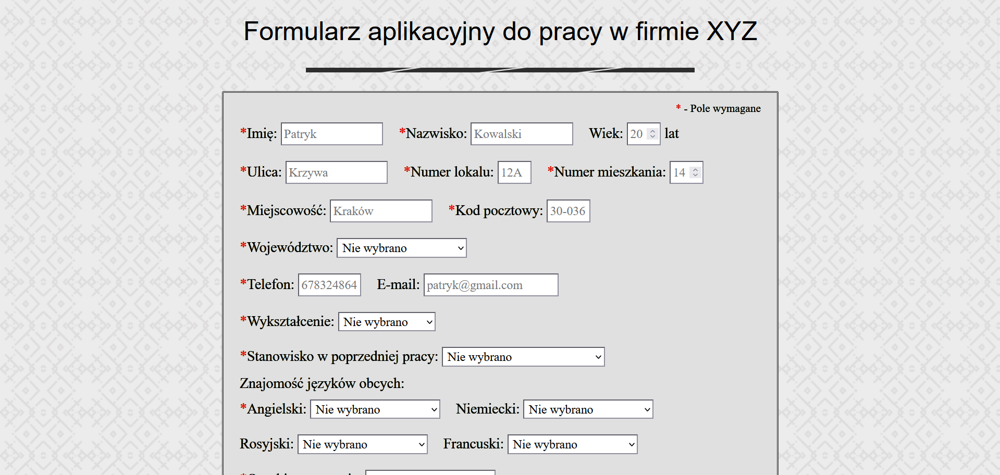
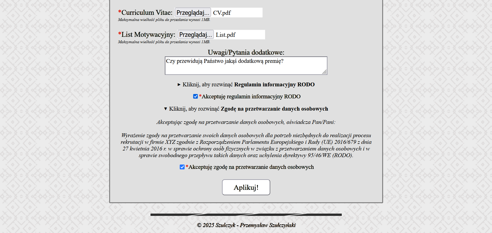
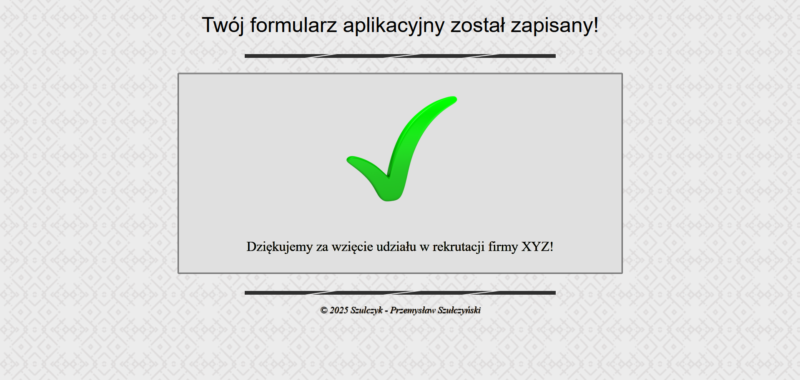
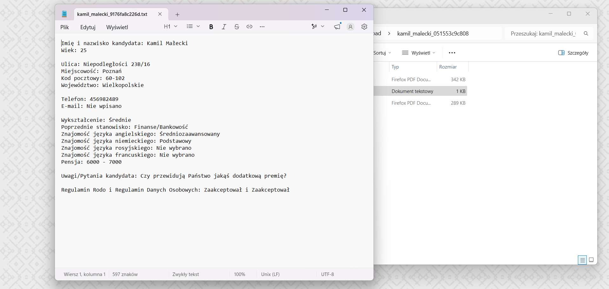

# ***[Projekt Praca](https://szulczyk.pl/projekt-18/praca)***

## 🖼️ ***Zrzuty ekranu***

 

## 📄 ***Opis projektu***
### ✅ *Projekt zakończony dnia 22.09.2025*
### *Projekt przedstawia formularz rekrutacyjny do fikcyjnej firmy XYZ. Użytkownik może wprowadzać swoje dane osobowe oraz przesyłać wymagane pliki przez przeznaczone do tego pola. System na bieżąco waliduje wprowadzane informacje oraz załączniki, informując o ewentualnych błędach lub pominięciu wymaganych pól. Po pomyślnej weryfikacji wszystkie dane wraz z plikami są bezpiecznie zapisywane na serwerze.*

 

## 🛠️ ***Stack projektu***
- ### *Frontend*
  - ### *HTML5*
  - ### *CSS3*
- ### *Backend*
  - ### *PHP*
- ### *Bazy danych*
  - ### *XML*

 

## 📌 ***Podsumowanie projektu***
### 🎯 *Projekt pozwolił mi przećwiczyć walidację danych po stronie serwera oraz po raz pierwszy wdrożyć i przetestować różnorodne scenariusze uploadu plików na serwer. Całość została uzupełniona o dynamiczne ładowanie plików XML, które zawierają regulamin informacyjny RODO i zgodę na przetwarzanie danych osobowych.*
### 💡 *Czego się nauczyłem:*
- ### *Dopasowanie interfejsu - zastosowałem intuicyjne pola formularza oraz zadbałem o spójny i estetyczny wygląd całej strony.*
- ### *Ochrona przed atakami i botami - zastosowałem skuteczne zabezpieczenia w postaci tokena CSRF w sesji PHP oraz mechanizm honeypot do blokowania automatycznych botów.*
- ### *Dwupoziomowa walidacja - opanowałem wiedzę z zakresu wzorców i weryfikacji danych wprowadzanych przez użytkownika zarówno po stronie frontendu, jak i backendu.*
- ### *Obsługa i walidacja plików - po raz pierwszy wdrożyłem przesyłanie plików na serwer i nauczyłem się sprawnie walidować je pod kątem najróżniejszych scenariuszy.*
- ### *Pewne zabezpieczenie danych - przeprowadziłem szczegółowe testy i kompleksowo zabezpieczałem zapisane dane, wykorzystując między innymi plik .htaccess.*

 

## 📨 ***Kontakt***
- ### 📧 *E-mail -* przemo.ppk@gmail.com
- ### 💻 *Discord -* darkcoder97